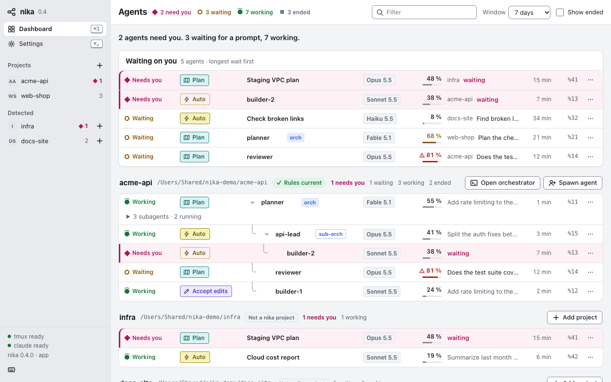
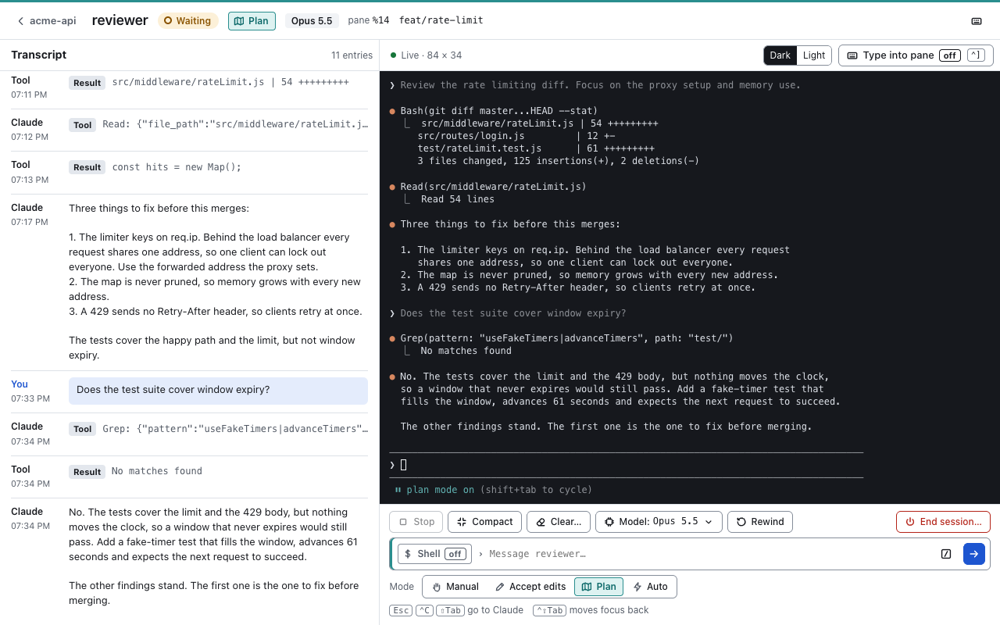
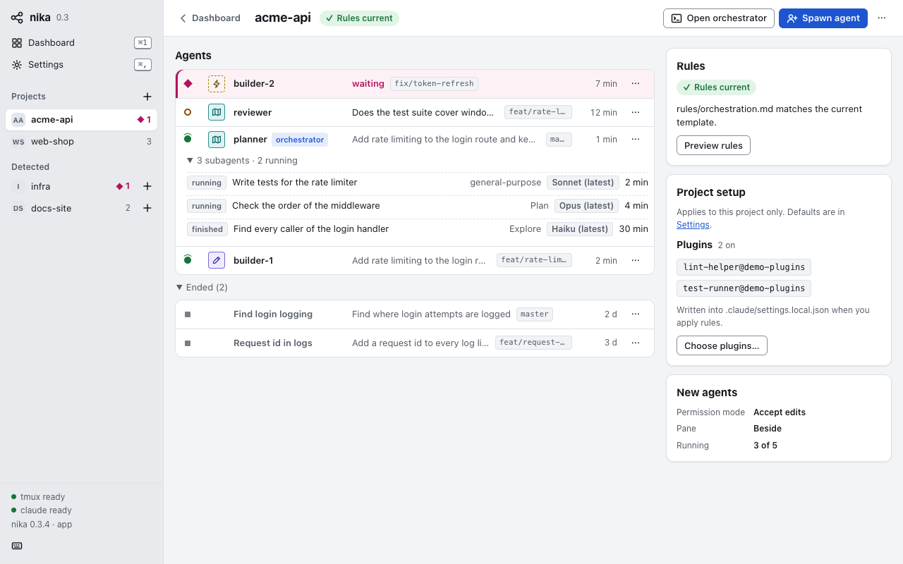
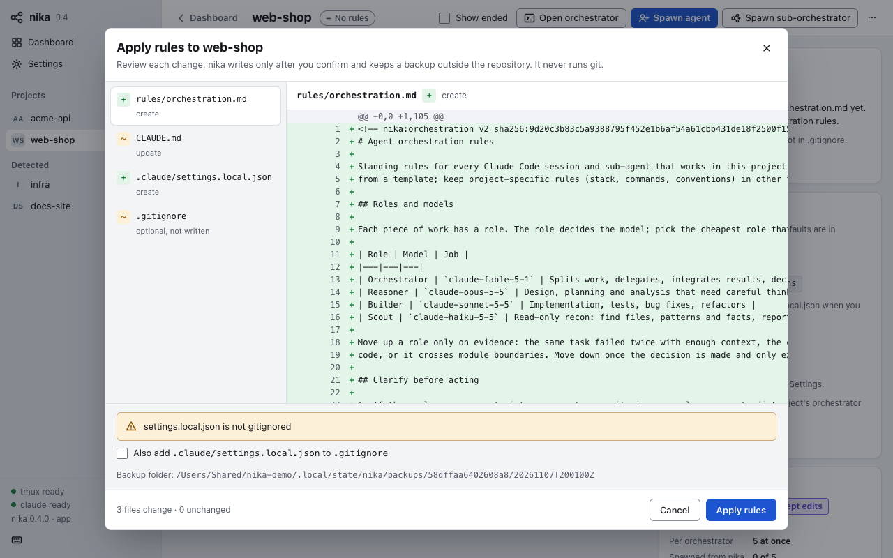
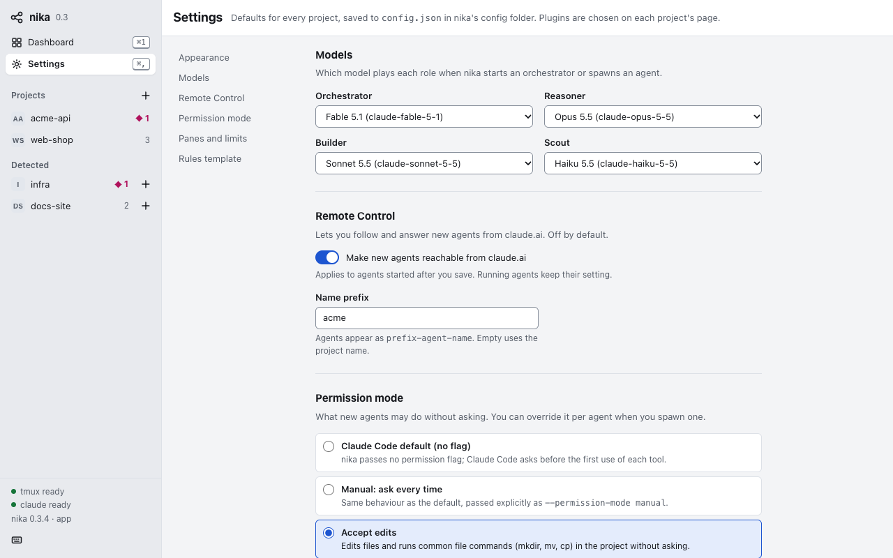
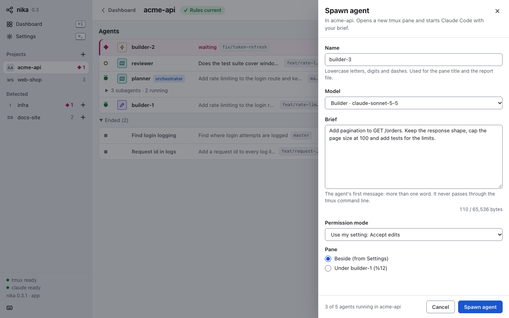

#  nika

A local dashboard of every Claude Code agent on your Mac: live sessions (working, waiting for input, running a shell) and recently ended ones, grouped by git repository, with their subagents nested inside.

<picture>
  <source media="(prefers-color-scheme: dark)" srcset="docs/screenshots/dashboard-dark.png">
  
</picture>

The desktop app's dashboard. Agents that need you come first, then every repository with its live agents; an orchestrator's agents and sub-orchestrators sit under it as a tree, and each row shows how full its context is (amber from 60 %, red from 80 %). The browser dashboard shows the same list without the sidebar and the controls. All screenshots show invented data.

- Groups by repository; git worktrees fold under their main repository and carry a worktree tag.
- Shows model, branch, tmux pane, last prompt, start and last-activity time, and the `STATUS:` line of orchestrator spawn reports.
- Actions per agent: **Focus pane** (switches tmux to it), **Open in claude.ai** (Remote Control sessions), **Copy resume** (`cd … && claude --resume <id>`), **Report** (spawn report file).
- Read-only apart from Focus pane. Zero dependencies (Node stdlib). Binds `127.0.0.1` only.

## Install (browser dashboard)

```sh
brew install qmpwwsd/tap/nika
brew services start nika     # runs at login on http://127.0.0.1:3335
nika                         # opens the dashboard in your browser
```

This is the browser tier. It stays read-only: it lists agents and can only focus a tmux pane. The privileged features of
the [desktop app](#desktop-app-02) are never available on `http://127.0.0.1:3335`.

## Commands

| Command | Does |
|---|---|
| `nika` / `nika open` | open the desktop app when it is installed, else the browser dashboard (the server must be running); see [CLI (0.2)](#cli-02) |
| `nika serve` | run the server in the foreground (what `brew services` runs) |
| `nika status` | print agents grouped by project; `--json`, `--since 24h\|7d\|30d\|all`, `--ended`, `--full` |
| `nika --version` | print the version |

## CLI (0.2)

`nika` and `nika open` start the desktop app when it is installed and fall back to the browser dashboard (the 0.1 behaviour: `nika serve` must be running). `nika open --app` fails with an install hint when the app is missing; `nika open --browser` skips the app. macOS opens the copy `nika app install` made in `~/Applications` by path, else looks the app up by bundle id (`open -b io.github.qmpwwsd.nika`); Linux runs `nika-app` from `PATH`, then `gtk-launch io.github.qmpwwsd.nika`.

| Command | Does |
|---|---|
| `nika app` | open the desktop app; fails with an install hint when it is missing |
| `nika app install` | macOS: copy or update the app in `~/Applications` (Spotlight, Launchpad); Linux: the `.deb` or AppImage installs the desktop entry |
| `nika serve --app` | the app tier's private server on a random port; the app starts it and talks to it over stdin/stdout, so it refuses a terminal on stdin (exit 2) |
| `nika projects list` | registered projects: key, name, rules state, folder |
| `nika projects add <dir>` / `remove <key>` | register a folder (stored as its real path) or unregister it; project files are never touched |
| `nika rules preview [dir]` | print the diffs of the orchestration rules nika would write into the project, plus warnings |
| `nika rules apply [dir]` | preview, ask `Apply? [y/N]`, then write; `--yes` skips the question (required without a terminal), `--overwrite-foreign` replaces a `rules/orchestration.md` nika did not write, `--gitignore` also adds `.claude/settings.local.json` to `.gitignore`. Backups go to nika's state folder, never into the repository; nika never runs git |
| `nika spawn <name> <model> <brief>` | start an agent in a tmux pane. Needs `$TMUX` (run it inside tmux) or `--session <name>`. `<brief>` is a file (at most 64 KB) or `-` for stdin. Options: `--project <dir>`, `--permission-mode <mode>` (`bypassPermissions` is refused), `--rc <prefix\|off>`, `--role <agent\|orchestrator>` (`orchestrator` starts a sub-orchestrator, only from the main orchestrator's pane; see [Orchestration (0.4)](#orchestration-04)), `--under <%pane>`. Prints pane, session and report path |
| `nika orchestrate [dir]` | create or reuse the project's tmux session and start the orchestrator pane. On a terminal it then attaches (inside tmux: switches the client to the session; otherwise `tmux attach-session`); `--detached`, or output that is not a terminal, only prints the session and pane |
| `nika doctor` | node, tmux, claude and app status (it warns when tmux is older than 3.2), nika's config and state folders with their modes, and config warnings |

`[dir]` is optional: it defaults to the registered project that contains the current directory (an explicit `dir` must be the project folder itself). Register a folder first with `nika projects add <dir>`.

Exit codes: `0` ok, `1` runtime error, `2` usage, `3` refused (invalid input, limit reached, foreign rules file without `--overwrite-foreign`, declined confirmation).

## Configuration

| Variable | Default | Meaning |
|---|---|---|
| `NIKA_PORT` | `3335` | port on 127.0.0.1 |
| `CLAUDE_CONFIG_DIR` | `~/.claude` | Claude Code config dir |
| `NIKA_TMP_ROOT` | `/private/tmp/claude-<uid>` | Claude scratchpad root searched for spawn reports |
| `NIKA_REPORT_DIRS` | – | extra report dirs, colon-separated |
| `NIKA_TMUX` | first `tmux` on `PATH`, then `/opt/homebrew/bin`, `/usr/local/bin` | tmux binary (3.2 or newer) |

With `brew services`, set variables in the service environment (for example with `launchctl setenv`) or run `nika serve` yourself.

The desktop app keeps its settings in `config.json` in `~/.config/nika` (under `NIKA_CONFIG_DIR` or `XDG_CONFIG_HOME` when
set). You change them in Settings and on each project's page, not by hand; a key that is wrong is dropped with a warning
(`nika doctor` shows it). Three keys came with 0.4:

| Key | Meaning |
|---|---|
| `compaction` | `{ enabled, pct, window }`: when the sessions nika starts compact. Default on, 80 %, 400k. Settings, **Auto-compact** |
| `perProject.<key>.models` | a model for any of `orchestrator`, `reasoner`, `builder` and `scout` in one project; a role left out follows Settings. The project page, **Project setup**, **Models** |
| `perProject.<key>.orchestratorSessionId` | the session id of the project's saved orchestrator, so nika can resume it. Set when you start or pick one |

`<key>` is the project's key (the first 16 hex characters of the SHA-256 of its real folder path). The older
`limits.maxAgents` now reads as **Agents per orchestrator**.

## What nika reads

| Source | Used for |
|---|---|
| `~/.claude/sessions/<pid>.json` | live sessions: cwd, status, tmux pane, Remote Control id |
| `ps -A -o pid=,lstart=` | is the process still alive (and not a reused pid) |
| `/proc/<pid>/stat` (Linux only) | one field, the process start time, for the pids in Claude's registry (at most 4 KB, your own processes only): tells a live session from a reused pid |
| `~/.claude/projects/*/<session>.jsonl` | first 64 KB and last 256 KB only: cwd, branch, model, title, last prompt, and from the last reply only its token counts and model id (for the context column; no text) |
| `…/<session>/subagents/agent-*.meta.json` | subagent type, description, model, finished |
| `tmux list-panes -a` | pane titles (`[%id] name` convention) and the four tags nika sets on the panes it starts (`@nika-role`, `@nika-agent`, `@nika-depth`, `@nika-parent`: who started whom), each read strictly |
| `<scratchpad>/reports/<name>.session\|.md\|.rc` | agent role name, `STATUS:` line, report text |
| nika's own `config.json` | the project list, each project's own settings and the auto-compact setting (the context column needs it); never a Claude settings file |
| `<cwd>/.git`, `commondir` | repository root for grouping |

It never reads `*.key` files, credentials or `.env` files. The browser tier never writes anything; what the app tier and the CLI write is listed in [docs/architecture.md](docs/architecture.md#where-writes-happen).

The app tier also reads, on demand: full transcripts (in pages), the screen of Claude's tmux panes (to mirror a pane and to read its permission mode and questions), and the first 4 KB of command and skill files in the Claude config folder, the project and installed plugins (front matter only, never the body). The exact list is in [rules/project-rules.md](rules/project-rules.md).

A transcript with no user or assistant message (Claude Code sometimes leaves a one-line title stub) is not an agent: nika lists it only while its session is live.

## Security

**Assumption: a single-user Mac.** Browsers on other sites cannot read or drive nika, but any local process or any other user account on the same machine can open `http://127.0.0.1:3335` and read what it shows: last prompts, directories, branches, session ids, Remote Control links and report text. Do not run nika on a shared machine.

- Listens on `127.0.0.1` only and rejects requests whose `Host` is not `127.0.0.1:<port>` or `localhost:<port>` (blocks DNS rebinding).
- `POST /api/focus` needs JSON, a per-process token embedded in the page, and a same-origin `Origin`; the pane id must look like `%<n>` and exist in tmux; tmux runs via `execFile`, never a shell.
- Report files are looked up by session id in nika's own index; no request carries a file path.
- Files in agent-writable dirs are opened without following symlinks, never block on FIFOs, must be regular files owned by you, and are read with a size cap.
- Text from transcripts, reports and tmux is stripped of control and bidi characters before it reaches the page or your terminal.
- Strict Content-Security-Policy; all session text is rendered as text, never HTML.

The desktop app's privileged tier is a separate, locked-down server; its threat model and residual risks are in [docs/security.md](docs/security.md).

## Desktop app (0.2)

0.2 adds a desktop app (macOS and Linux, tray icon) with a privileged tier: session window with history and a live pane
mirror, spawning agents in tmux, starting the orchestrator, adding projects and applying orchestration rules. 0.3 adds
session control to that window: permission modes, permission prompts, quick actions, slash commands and End (see
[Session window (0.3)](#session-window-03)). The browser dashboard above stays read-only.

**Requirements:** Node.js 22 or newer, tmux 3.2 or newer (the app's agent control: starting agents, the pane mirror, typing into sessions) and Claude Code (`claude`). The app does not bundle Node.js. Homebrew installs Node.js and tmux with nika, and the `.deb` installs tmux. The AppImage cannot declare dependencies, so install tmux and Node.js 22+ before you run it.

### Install

**macOS.** The Homebrew formula builds the app from source (Homebrew installs Rust as a build dependency; the build
takes a few minutes and needs a few GB of free disk space):

```sh
brew install qmpwwsd/tap/nika             # or, from 0.1: brew update && brew upgrade nika
nika app install                          # once: copies the app to ~/Applications so Spotlight and Launchpad find it
brew autoremove                           # optional: removes Rust and the other build-only dependencies
```

The desktop app lives in the Homebrew folder, which Spotlight does not index; `nika app install` copies it into
`~/Applications` (the app also offers an "Add to Applications" button once). After `brew upgrade`, running `nika` brings
that copy up to date; a launch (`nika`, `nika open`, `nika app`) never touches a copy nika did not make, and nika never
replaces anything in `~/Applications/nika.app` that is not nika's own bundle. It never writes to `/Applications`.
After an upgrade, restart the browser dashboard with `brew services restart nika`.

**Linux (x86_64).** Download the `.deb` or the AppImage and `SHA256SUMS` from the
[latest release](https://github.com/qmpwwsd/nika/releases/latest), then:

```sh
sha256sum -c SHA256SUMS --ignore-missing
sudo apt install ./nika_*_amd64.deb       # Debian and Ubuntu; or run the AppImage directly
```

The `.deb` pulls in tmux 3.2 or newer but not Node.js: the `nodejs` package of most Debian and Ubuntu releases is older than 22. Get
Node.js 22 from [NodeSource](https://github.com/nodesource/distributions) or with a version manager. The app finds
Node.js in these places, in this order: Homebrew, `/usr/local/bin`, Linuxbrew's `/home/linuxbrew/.linuxbrew`,
`~/.local/bin`, Volta, then mise, fnm, nvm and asdf (their default folders) and `/usr/bin`. It uses the first one that is
22 or newer. For anything else, set `NIKA_NODE` to the absolute path of the `node` binary. If it finds only an older Node.js, the app says so and shows the version it found.

Or build the app yourself from a checkout, as below.

### Build from source: macOS

```sh
brew install rustup
export PATH="$(brew --prefix rustup)/bin:$HOME/.cargo/bin:$PATH"   # the Homebrew rustup is keg-only
rustup default stable
cargo install tauri-cli --version 2.12.4 --locked
cd app/src-tauri && cargo tauri build --bundles app
```

The bundle is `app/src-tauri/target/release/bundle/macos/nika.app`. Copy it to `~/Applications` and open it once. It is
signed ad hoc and not notarized, so a copy moved to another Mac is blocked by Gatekeeper (details in
[docs/packaging.md](docs/packaging.md)).

### Build from source: Linux

```sh
sudo apt install libwebkit2gtk-4.1-dev build-essential curl wget file libxdo-dev libssl-dev \
  libayatana-appindicator3-dev librsvg2-dev      # Debian and Ubuntu build dependencies
cargo install tauri-cli --version 2.12.4 --locked   # with Rust installed through rustup
cd app/src-tauri && cargo tauri build --bundles deb,appimage
```

At runtime the app needs WebKitGTK 4.1 and AppIndicator (`libayatana-appindicator3-1`) for the tray icon.

### Run it

```sh
nika app      # or just: nika
```

`nika` opens the app when it is installed and falls back to the browser dashboard. A tray icon appears. On macOS nika is
also in the Dock and in Cmd+Tab while its window is open; closing the window hides it and leaves only the tray icon. The
green button, View > Enter Full Screen or Ctrl+Cmd+F makes the window full screen. **Quit nika** in the tray menu stops
the app and its private server; your tmux sessions and agents keep running. "Start at login" is off by default.

More: [docs/packaging.md](docs/packaging.md) (build details, signing, Linux packages),
[docs/security.md](docs/security.md) (threat model, residual risks, how to report a vulnerability),
[docs/architecture.md](docs/architecture.md) (processes, boot sequence, module map). Contracts:
[docs/contracts/api-app.md](docs/contracts/api-app.md); decisions: [docs/adr/](docs/adr/); progress:
[CHANGELOG.md](CHANGELOG.md).

### Using the app

- **Dashboard.** One line says how many agents need you, are waiting or are working. Agents that need you are listed first
  under "Waiting on you", then every repository with its live agents (needs you, waiting, working). Ended agents are hidden:
  a repository with only ended agents says "No live agents."; tick **Show ended** to list them in an "Ended" section under
  each repository (open; fold it by hand and it stays folded until you tick the box again). Claude's finished subagents
  stay hidden the same way. The project page has its own **Show ended** box. When Claude's session files cannot all be
  read, a muted note says how many were skipped. Filter by text and change the
  time window. Click a row to open its session window. Rows whose Claude pane nika can read
  also show the agent's permission mode as a tag, and their menu has **End session…**.
- **Sidebar.** **Projects** lists your registered projects with their live or needs-you count; with none it says "No
  projects yet." and points to the "+". Under **Detected** it lists repositories that run live agents but are not projects
  yet (8 at first, the ones that need you first, then an "N more" button). The row shows that repository on the dashboard; its small "+" opens the
  folder picker, like the sidebar "+".
- **Add a project.** The sidebar "+" (or `Mod+O`) opens the native folder picker. The project page notes when the folder is
  not a git repository. A new project has no orchestration rules yet: use **Apply rules** to preview the exact diffs, then
  confirm. nika writes only the files shown in the preview, keeps a backup outside the repository and never runs git.
  The `@rules/orchestration.md` line goes into `CLAUDE.md`, and also into `AGENTS.md` when the project has one; a project
  with only `AGENTS.md` gets no new `CLAUDE.md`, since Claude Code would then stop reading `AGENTS.md`.
- **Start an orchestrator / spawn an agent.** From a project: **Start orchestrator** opens its tmux session and pane
  (**Resume orchestrator** when the project has a saved one that ended);
  **Spawn agent** and **Spawn sub-orchestrator** open a side sheet (name, model, brief up to 64 KB, permission mode, pane placement). A project at its
  agent limit shows why and what to do. `bypassPermissions` is not offered. Neither needs a terminal or a running tmux:
  nika starts the project's tmux session when there is none. If Claude exits right after it starts (for example, it
  needs a login), the project page says so; run `claude` once in a terminal in that folder to see why. See
  [Orchestration (0.4)](#orchestration-04).
- **Settings** (`Mod+,`). Appearance (System, Light, Dark) and the **Single-key shortcuts** switch, the model per role (a
  list of current models and aliases, or a custom ID), Remote Control, default permission mode and pane placement, the
  agent limit per orchestrator, **Auto-compact** and the rules template: defaults for every project. The Save and Discard bar appears only after a change; invalid fields are marked in place.
- **New agents, per project.** The project page's **New agents** card shows the permission mode, pane placement and agent
  limit this project's new sessions get. Click a value to pick this project's own, or **Use Settings** to follow the
  default (marked "from Settings"). They apply to Start and Resume orchestrator, to Spawn agent and Spawn
  sub-orchestrator, and to the rules file when you apply rules. `bypassPermissions` is not offered.
- **Project setup.** On the project page, the **Project setup** card lists the plugins that project turns on and the models it sets for its roles; **Choose plugins…**
  opens a window to tick the plugins (filter, count, Save), **Choose models…** one to set a model per role. Plugins are written into the project's `.claude/settings.local.json` when you apply rules.
- **Keyboard.** `Mod+1` dashboard, `Mod+,` settings, `Mod+O` add project, `Mod+F` filter, `Mod+[` (macOS) or `Alt+Left`
  (Linux) back (the project view and Settings go to the dashboard; the session window goes to its project, or the
  dashboard when it has none), `Mod+Enter` confirm the open
  dialog, or save settings when there are unsaved changes, `?` or `Mod+/` the Keyboard shortcuts window. `Mod` is Command on macOS and Control on Linux.
- **Keyboard shortcuts window.** `?` or `Mod+/`, or the Keyboard shortcuts button (sidebar footer, session header), lists
  the shortcuts of the screen you are on. `?` is ignored while you type in a field or in the pane mirror, while "Type into
  the pane" is on and while a dialog is open; turn it off in Settings, Appearance, **Single-key shortcuts** (useful with
  speech input). `Mod+/` also works in fields and with the setting off (not while a dialog is open, nor
  in passthrough on Linux). The browser dashboard has the same window with `Mod+/` only, from a button in
  its top bar.

The browser dashboard at `http://127.0.0.1:3335` shows the same list without any of these controls; its only action is
**Focus pane**.

### Screenshots

<picture>
  <source media="(prefers-color-scheme: dark)" srcset="docs/screenshots/session-dark.png">
  
</picture>

**Session window.** The header (with the session's context meter), the transcript, a live mirror of the agent's tmux pane, the quick actions (Stop, Compact, Clear, Model, Rewind, End session), the message box and, under it, the permission-mode switcher. The **Transcript** button (or `Mod+Shift+H`) hides the transcript so the terminal takes the full width.

<picture>
  <source media="(prefers-color-scheme: dark)" srcset="docs/screenshots/project-dark.png">
  
</picture>

**Project view.** The project's agents as a tree under the orchestrator, with their subagents and context use, and cards for its rules, its project setup (plugins and models) and the settings new agents start with. The buttons above the cards open the orchestrator and spawn an agent or a sub-orchestrator. On a window 1030 px wide or narrower the cards move into a **Setup** drawer that the button next to them opens.

<picture>
  <source media="(prefers-color-scheme: dark)" srcset="docs/screenshots/rules-dark.png">
  
</picture>

**Apply rules.** Every file nika would write, as a diff, and the backup folder. Nothing is written until you confirm, and nika never runs git.

<picture>
  <source media="(prefers-color-scheme: dark)" srcset="docs/screenshots/settings-dark.png">
  
</picture>

**Settings.** The model for each role, Auto-compact and Remote Control. The permission mode for new agents, the agent limit per orchestrator and the rules template are further down; plugins, per-project models and a project's own permission mode, pane placement and agent limit are chosen on each project's page.

<picture>
  <source media="(prefers-color-scheme: dark)" srcset="docs/screenshots/spawn-dark.png">
  
</picture>

**Spawn agent, or sub-orchestrator.** A name, a model, the brief, a permission mode and where the pane opens; the sheet also shows the parent and lets you choose Agent or Sub-orchestrator, and its footer counts how many each limit allows ("planner: 3 of 5 · acme-api: 4 of 15 running"). The shot shows a sub-orchestrator being started under the orchestrator. The session starts in a new tmux pane.

### Session window (0.3)

Click an agent to open its session window: history, a live mirror of its tmux pane and a message box. On windows wider
than 1000 px the **Transcript** button at the left of the terminal's header (or `Mod+Shift+H`) hides the transcript so the
terminal has the full width, and shows it again; narrower windows use the Terminal and Transcript tabs instead. The
choice is kept until nika quits. The controls below
work on a pane that is a live Claude session (or one nika started) and runs `claude` right now. They read Claude's
screen, so a screen nika does not recognize shows "Mode ?" or leaves a control disabled, with the reason under it.

- **Modes.** A tag in the header, a frame along the top and the message-box edge show Claude's permission mode: Manual,
  Accept edits, Plan, Auto, Bypass, Don't ask, or "Mode ?". The switcher under the message box moves between Manual,
  Accept edits, Plan and Auto by pressing Shift-Tab for you, only while Claude is waiting for you with no question open;
  it reads the screen again after every press (at most 6). Bypass and Don't ask are shown, never chosen. While a
  question covers Claude's footer, the tag shows the last known mode, marked unconfirmed (dashed).
- **Keys.** With the message box focused, Esc, Ctrl+C and Shift+Tab go to Claude: Esc presses Esc, Ctrl+C stops Claude's
  turn as Stop does (only while Claude works, and not while text is selected), and Shift+Tab presses Shift-Tab (the next
  permission mode; it waits until the window has read the pane, and while Claude asks you something). With the box
  empty, the arrow keys and Enter go to Claude too (its menus and earlier prompts); arrow presses go out in batches of
  up to 8 keys, each sent at its 8th press or 120 ms after its first. Tab moves focus; Ctrl+Shift+Tab moves it back.
  Copy, cut, paste, select all, undo and redo work as usual in every text field. In the message box Ctrl+C is Stop only
  with nothing selected (with a selection the text field keeps it: a copy on Linux), and Ctrl+Shift+C never stops
  Claude. In Type
  into pane, Ctrl+Shift+C copies the text selected in the terminal, and Ctrl+Shift+V (and Ctrl+V on Linux) pastes into
  Claude. On Linux, Ctrl+Q quits nika, Ctrl+W closes the window (in Type into pane it goes to Claude) and
  Ctrl+Plus, Ctrl+Minus and Ctrl+0 zoom; on macOS the app menu has these keys. Cmd+/ (Ctrl+/ on Linux) lists every shortcut.
- **Questions.** When Claude asks for permission, one button per option answers it (nika types that option's number),
  plus an Esc button (cancel, same as No). An option that mentions bypass has no button: answer it in the terminal.
- **Quick actions.** **Stop** (live only while Claude works; it presses Esc, and Esc twice when Claude's input is in
  vim insert mode, and it also stops running subagents), **Compact**, **Clear** (asks first), **Model** (the list, or a
  custom ID), **Rewind** (types `/rewind` and Enter, which opens Claude's rewind menu in the pane for you to pick a
  point) and **End session**. Compact, Clear, Model and Rewind are live while Claude waits for you; a line under the row
  says why one is off.
- **End session.** Asks first. If Claude is busy or asking, nika presses Esc once (which answers a question with No),
  then types `/exit` and Enter. It never kills the pane; if Claude does not exit it says so ("Claude didn't exit; use
  Stop or the terminal.").
- **Claude's input must be empty.** Compact, Clear, Model, Rewind and End type into Claude's own input and press Enter only when
  it reads exactly that command. If there is a draft in it, they refuse with "Claude's input has a draft. Send or clear it
  in the terminal, then try again." and leave your text alone. If nika cannot find the input box (a menu or another
  screen is open in the pane), they refuse with "nika can't find Claude's input box, so nothing was typed. Close any menu
  in the terminal (Esc), then try again." and type nothing.
- **Shell.** The Shell toggle sends the line through Claude's `!` mode (Ctrl-U first, which clears the current line of Claude's
  input, then `!`, the line and Enter) and then turns itself off.
- **Send and Shell wait for a question.** While Claude asks for permission, Send (a line, a paste, or Enter from an
  empty box) and Shell send nothing and say "Answer the prompt with the buttons above or in the terminal."; your text
  stays in the box. Enter and Shift+Tab in the message box send nothing either, once nika has seen the prompt: the
  window learns of a question from its last read of the pane (up to about a quarter of a second old), so a key pressed
  in that instant can still reach it, and Shift-Tab there can pick "allow for this session". A question nika cannot
  parse has no buttons: the line and the note then say to answer in the terminal or turn on Type into pane. A question
  that mentions bypass anywhere on its screen gets no answer buttons at all, and nika refuses Enter, Shift-Tab, digits
  and pastes to it: answer in the terminal.
- **After `/clear`.** When Claude starts a new conversation in the pane, the window follows it to the new session (the
  transcript starts over) instead of showing the ended one.
- **Commands.** Type `/` at the start of an empty message box, or press Commands, to filter Claude's built-in commands
  and the commands and skills from your Claude config folder, the project and installed plugins, each with a source tag.
  Enter inserts `/name `; a second Enter sends it.

If a screen nika cannot read blocks a control, use the keys in the message box (Esc, Shift+Tab, the arrows in an empty
box), Type into pane, or your terminal. The routes behind these controls and their limits are in
[docs/contracts/api-app.md](docs/contracts/api-app.md) (section 3); the threats, in [docs/security.md](docs/security.md)
(T22, T23, T26).

### Orchestration (0.4)

The orchestrator is the Claude session that plans the work and starts agents for it. 0.4 lets you keep and reuse it, split
work across levels, and stop sessions from running out of context. All of it is in the desktop app; the browser dashboard
shows the tree and the context column, read-only.

- **Pick or resume an orchestrator.** **Start orchestrator** on a project's page starts one in the project's tmux session
  and remembers its session. After it ends, the same button says **Resume orchestrator** and continues that conversation.
  To use a Claude session you already run (in tmux, or ended), open its row menu: **Set as orchestrator** or **Resume as
  orchestrator**. **Stop using as orchestrator** only forgets the choice; a running session keeps running. A project has one
  orchestrator running at a time. An agent you spawn under an orchestrator you adopted from your own tmux session opens
  beside it, in that session.
- **Sub-orchestrators and the tree.** The orchestrator can start sub-orchestrators (**Spawn sub-orchestrator** on the
  project page, or `nika spawn … --role orchestrator` from the orchestrator's pane), and a sub-orchestrator can start
  agents. That is three levels at most, and an agent never starts another agent. The dashboard and the project page draw
  them as a tree: each level is indented, and the button before a parent's name folds its agents (a folded row says how
  many are hidden and how many need you). Ended agents, the "Waiting on you" queue and filtered lists stay flat. A
  sub-orchestrator may run only `nika spawn` and `nika status`; the other nika commands are on its deny list (advisory
  like the agents' list; see [docs/security.md](docs/security.md), T36).
- **Limits.** **Agents per orchestrator** (Settings, 1 to 8) caps the agents and sub-orchestrators under each parent. A
  project as a whole runs at most three times that number, never more than 24. The spawn sheet shows both counts, and a
  spawn that would pass a limit is off, with the reason as its tooltip.
- **Models per project.** On the project page, **Project setup**, **Models** lists the roles this project sets and
  **Choose models…** changes them (Orchestrator, Reasoner, Builder, Scout; **Use default** follows Settings). They apply
  the next time nika starts or resumes the orchestrator, in the spawn sheet, and in `rules/orchestration.md` once you apply
  rules again. Running sessions keep their model.
- **Auto-compact.** Settings, **Auto-compact**: "Auto-compact at 80 % of 400k", on by default. Every claude nika starts
  after that (the orchestrator, agents, sub-orchestrators) compacts at that point; nika passes it two environment
  variables, `CLAUDE_CODE_AUTO_COMPACT_WINDOW` and `CLAUDE_AUTOCOMPACT_PCT_OVERRIDE`, and never your Claude settings.
  Sessions that are already running, and sessions you start yourself, keep Claude Code's own setting. It needs tmux 3.2 or
  newer: on an older tmux the orchestrator may not start until you turn Auto-compact off. Why: [ADR 0014](docs/adr/0014-auto-compact-launch-env.md).
- **Context column.** Every row on the dashboard and the project page, in the browser too, shows how much of the window
  the session's context fills: a percentage with a thin bar, amber from 60 %, red with a warning icon from 80 %, and "–"
  while there is no usage yet. With the default 80 % setting, 80 % means a session nika started is about to compact; the
  tooltip always says where it compacts. The numbers come from the last reply in the transcript (token counts only, no text).

Why the tree works the way it does: [ADR 0013](docs/adr/0013-nested-orchestration.md).

## Development

```sh
npm test                  # node --test, no dependencies
node bin/nika serve       # http://127.0.0.1:3335
node bin/nika status
node scripts/screenshots.mjs  # rebuilds docs/screenshots/*.png; needs Google Chrome or Chromium, uses only invented data
(cd app/src-tauri && cargo test --locked)   # the desktop shell, needs Rust
docker build -f Dockerfile.test -t nika-verify . && docker run --rm nika-verify   # Linux checks (scripts/linux-verify.sh)
```

## Uninstall

```sh
brew services stop nika
brew uninstall nika
```

## License

MIT
